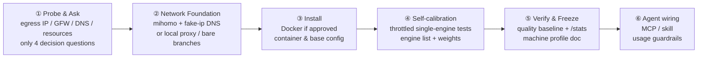

<p align="center">
  
</p>

<h1 align="center">SearXNG Forge</h1>

<p align="center">Host the highest-quality search your own infrastructure can deliver.</p>

<p align="center"><b><a href="README.md">简体中文</a> · <a href="README.en.md">English</a></b></p>

An agent skill designed to take self-hosted [SearXNG](https://github.com/searxng/searxng) from broken, CAPTCHA-ridden defaults to the highest operational standard your network allows — covering network prerequisites, dynamic engine calibration, rank weighting, and agent integration in a unified workflow.

## Quick start (no terminal experience required)

If you use an AI coding assistant such as zcode or Claude Code, paste the prompt below into your assistant and let it handle execution:

```text
Please deploy and tune a self-hosted SearXNG search engine for me. First run this installer:
curl -fsSL https://raw.githubusercontent.com/Clickist/searxng-forge/main/install.sh | bash
Then follow the searxng-forge skill: probe the environment before asking me anything,
get my approval for every system-level change, and wire search into your own toolchain at the end.
```

For terminal users, run the installer directly, then prompt your assistant to "deploy and tune SearXNG with searxng-forge":

```bash
curl -fsSL https://raw.githubusercontent.com/Clickist/searxng-forge/main/install.sh | bash
```

## Why you need it

Default deployments of SearXNG frequently disappoint: DuckDuckGo triggers CAPTCHAs, Google yields empty responses, and Wikipedia returns HTTP 403. Most tutorials advise toggling alternative engines, but configuration tweaks rarely resolve the underlying failures:

- **Egress IP reputation**: Search engines enforce strict rate limits and challenges on datacenter (ASN) ranges compared to residential connections.
- **DNS poisoning**: In restrictive network environments, poisoned DNS queries prevent requests from reaching authentic origin servers.
- **Bot fingerprinting**: Naked client signatures trigger defensive responses from upstream providers, often resulting in syntactically valid but completely irrelevant SERPs.

Altering engine lists without resolving infrastructure constraints merely treats symptoms. **SearXNG Forge structures environment remediation and engine tuning into an ordered pipeline:**



## Benchmarks and real-world results

SearXNG Forge includes a `benchmark.sh` test suite measuring 8 real-world bilingual queries against authoritative domain hits using the success@5 metric. This provides quantifiable comparisons both during initial tuning and for subsequent regression checks.

Representative results from a constrained environment (2 GB RAM Armbian device, behind the GFW, routed via a self-hosted Singapore egress node):

| Metric | Before | After |
|---|---|---|
| Working engines | 1 (bing alone) | 16+ (full zh/en lineup) |
| Chinese general query | CAPTCHAs / sparse | 35 results, zero unresponsive |
| success@5 baseline | — | **75%** (above healthy line) |
| github / npm / ddg news / google cse | all timeouts | all revived |

## Why it stays reliable for years

Most guides fail because search engine defenses and upstream interfaces evolve constantly; hardcoded configuration templates decay within weeks. This skill is engineered around principles rather than static states:

- **Codify methodology, not static snapshots.** Packaged engine recommendations include explicit timestamp metadata and must be re-validated at runtime. Configuration templates serve only as baselines; each host calibrates its own active engine set.
- **Isolate evidence collection from evaluation logic.** While poisoned IP subnets and engine rosters shift, the evaluation model—comparing query outcomes against deterministic ground truth—remains consistent.
- **Prioritize upstream image updates over local patches.** The SearXNG core project actively tracks upstream breaking changes (such as adopting curl_cffi for browser impersonation to address DuckDuckGo challenges). Following upstream fixes is formalized in the skill's standard operating procedure.

## Honest limits

- **Egress reputation is an infrastructure reality, not a software configuration.** Mainline Google search is largely inaccessible from standard datacenter IPs (and disabled by default upstream), while Bing access remains variable. The skill focuses on maximizing datacenter-tolerant engines (such as DuckDuckGo, Brave, Wikipedia, GitHub, and arXiv) while explicitly identifying engines that cannot function reliably on the host.
- **Direct connections without proxy routing in restricted regions**: Overseas providers will remain predominantly inaccessible. The workflow surfaces these constraints transparently for informed decisions rather than attempting futile workarounds.
- **Prerequisite resources**: Network egress and bandwidth remain the user's responsibility (commercial proxies, self-hosted relays, or international VPS instances; the skill adapts its deployment path accordingly).

## FAQ

**Q: Does it modify host system configurations?**
Any privileged operation—such as installing Docker, configuring mihomo, or updating iptables—requires explicit explanation and user authorization prior to execution. Initial environment discovery is strictly read-only.

**Q: Why self-host instead of querying Google or DuckDuckGo directly?**
- **Privacy**: Search requests are fragmented across multiple upstreams without centralized tracking or targeted ads.
- **Autonomy**: You maintain full ownership of system profiles and expose an unauthenticated local JSON API optimized for AI agent consumption.
- **Resilience**: Aggregating diverse sources mitigates regional network degradations and algorithmic changes from any single commercial provider.

**Q: Which AI agent architectures are supported?**
The skill integrates with both native agent skill systems and Model Context Protocol (MCP) clients. Because SearXNG exposes an unauthenticated HTTP JSON API, integration involves generating targeted configuration snippets and operating instructions for your agent environment at runtime.

**Q: How can I re-run the quality baseline?**
Execute `bash scripts/benchmark.sh http://127.0.0.1:8080`. Running the benchmark is recommended following network egress adjustments or major image version upgrades.

## License

MIT

## Credits

- The [SearXNG](https://github.com/searxng/searxng) project and its engine maintainers
- Community reference: SSDNodes, [SearXNG Engines to Enable and Disable on a VPS](https://www.ssdnodes.com/learn/searxng-engines-to-enable-and-disable)
