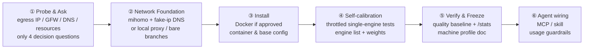

<p align="center">
  
</p>

<h1 align="center">SearXNG Forge</h1>

<p align="center">Host the highest-quality search your own resources can deliver.</p>

<p align="center"><b><a href="README.md">简体中文</a> · <a href="README.en.md">English</a></b></p>

An agent skill that takes a self-hosted [SearXNG](https://github.com/searxng/searxng) from "everything is CAPTCHAs" to "the best your machine's network can possibly be" — network foundation, per-machine engine self-calibration, ranking weights, and wiring it into your AI agent, in one pipeline.

## Zero-threshold start (no terminal knowledge required)

If you have an AI coding assistant like zcode or Claude Code, just paste this to it and let it drive:

```text
Please deploy and tune a self-hosted SearXNG search engine for me. First run this installer:
curl -fsSL https://raw.githubusercontent.com/clickist/searxng-forge/main/install.sh | bash
Then follow the searxng-forge skill: probe the environment before asking me anything,
get my approval for every system-level change, and wire search into your own toolchain at the end.
```

Terminal-savvy? Install it yourself, then tell your assistant "deploy and tune SearXNG with searxng-forge":

```bash
curl -fsSL https://raw.githubusercontent.com/clickist/searxng-forge/main/install.sh | bash
```

## Why you need it

The default self-hosted SearXNG experience: DuckDuckGo wants a CAPTCHA, Google returns nothing, Wikipedia 403s. Tutorials say "try another engine" — but the real causes are almost never in SearXNG's config:

- Your egress IP is a datacenter IP; search engines trust it far less than a residential one
- Behind the GFW, your DNS answers are poisoned — engines never even get reached at the right server
- Your request fingerprint looks like a bot, so engines serve "poisoned" SERPs: structurally valid results with irrelevant content

Until these are fixed, tuning engine lists is scratching an itch through a boot. **SearXNG Forge turns foundation and tuning into an ordered pipeline:**



## What level does tuning reach

A built-in `benchmark.sh` quality baseline (8 real zh/en queries with gold-domain hits, success@5) gives you numbers before/after tuning and for long-term regression. Real-machine results (a 2 GB Armbian box, behind the GFW, egress via a self-hosted Singapore node):

| Metric | Before | After |
|---|---|---|
| Working engines | 1 (bing alone) | 16+ (full zh/en lineup) |
| Chinese general query | CAPTCHAs / sparse | 35 results, zero unresponsive |
| success@5 baseline | — | **75%** (above healthy line) |
| github / npm / ddg news / google cse | all timeouts | all revived |

## Why it stays useful for years

Every tutorial's weak spot: engine ecosystems and anti-bot measures change monthly, so hardcoded configs rot in weeks. This skill inverts the design:

- **Distills methods, not snapshots.** Built-in engine findings are date-stamped snapshots that must be re-tested at run time; config templates are only starting points, and every machine generates its own list via self-calibration.
- **Scripts collect evidence; judgment lives in the process.** Poisoned-IP signatures and engine rosters change; the method of comparing and deciding does not.
- **Upgrading the image beats tweaking config.** Upstream keeps fixing engine workarounds (the 2026 DDG block was officially solved by shipping curl_cffi browser impersonation in the image) — that principle is baked into the SOP.

## Honest limits

- **Egress IP reputation is a resource problem, not a config problem.** On datacenter IPs the main Google engine is effectively dead (disabled upstream), and Bing fluctuates. What this skill does: max out the datacenter-friendly lineup (DDG / Brave / Wikipedia / GitHub / arXiv) and tell you plainly which engines just won't work on your box.
- **Behind the GFW with zero proxy resources**: overseas engines are mostly unreachable; the skill lays out reality and lets you decide instead of pretending.
- Bandwidth and IP are yours to bring (airport subscription, self-hosted node, or an overseas VPS — the skill branches accordingly).

## FAQ

**Q: Will it touch my system?** System-level actions (installing Docker / mihomo, editing iptables) each get explained and approved first. Read-only probing needs no approval.

**Q: How is this different from just using ddg/google?** Privacy (queries spread across engines, no ad tracking), control (your own profile doc, agents hit the JSON API directly), and not being at the mercy of any single engine.

**Q: Which agents can it wire into?** Both skill-based and MCP-based agents. SearXNG's JSON API is auth-free HTTP; wiring means handing your agent a manual, with config generated at run time.

**Q: How do I re-run the baseline?** `bash scripts/benchmark.sh http://127.0.0.1:8080` — recommended after egress changes or major upgrades.

## License

MIT

## Credits

- The [SearXNG](https://github.com/searxng/searxng) project and its engine maintainers
- Community reference: SSDNodes, [SearXNG Engines to Enable and Disable on a VPS](https://www.ssdnodes.com/learn/searxng-engines-to-enable-and-disable)
