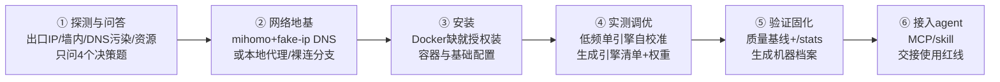

<p align="center">
  
</p>

<h1 align="center">SearXNG Forge</h1>

<p align="center">用你自己的资源，host 出你能拥有的最高质量的搜索。</p>

<p align="center"><b><a href="README.md">简体中文</a> · <a href="README.en.md">English</a></b></p>

一个 agent skill：在你的服务器 / 本机 Docker 上把 [SearXNG](https://github.com/searxng/searxng) 从"装完全是 CAPTCHA"调到"这台机器网络条件下的最优"——网络地基、引擎自校准、权重排序、接入你的 AI agent，一条流程走完。

## 零门槛开始（不会终端也没关系）

如果你的电脑上有 zcode、Claude Code 这类 AI 编程助手，直接把下面这段话复制粘贴给它，剩下的交给它：

```text
请帮我部署并调优 SearXNG 自托管搜索引擎。先执行这个安装命令：
curl -fsSL https://raw.githubusercontent.com/clickist/searxng-forge/main/install.sh | bash
装好后按 searxng-forge 这个 skill 的流程走：先探测环境再问我必要的问题，
系统级操作逐一征求我同意，最后把搜索接入你自己的工具链。
```

熟悉终端的话，也可以自己装好后对 AI 助手说"用 searxng-forge 部署调优 SearXNG"：

```bash
curl -fsSL https://raw.githubusercontent.com/clickist/searxng-forge/main/install.sh | bash
```

## 为什么你需要它

自建 SearXNG 的默认体验通常是：装好了，一搜，DuckDuckGo 要验证码、Google 零结果、Wikipedia 403。网上教程会告诉你"换个引擎试试"，但真正的原因几乎从来不在 SearXNG 的配置里：

- 你的出口 IP 是机房 IP，搜索引擎对它的信任度和家宽完全不同
- 如果你在墙内，DNS 解析本身就被污染——引擎连"正确的服务器"都摸不到
- 你的请求指纹像爬虫，引擎会"放毒"：返回结构正常但内容无关的垃圾结果

这些问题不解决，怎么调引擎清单都是隔靴搔痒。**SearXNG Forge 把地基和调优做成了有先后依赖的流水线：**



## 调优后是什么水平

内置 `benchmark.sh` 质量基线（8 个中英文真实查询 + 权威域名命中，success@5 口径），调优前后跑分对比、长期回归都有数字可依。实机战绩（2GB 内存的 Armbian 小盒子，墙内 + 自建新加坡节点出口）：

| 指标 | 调优前 | 调优后 |
|---|---|---|
| 可用引擎 | 1 个（bing 独苗） | 16+ 个（中英文全梯队） |
| 中文综合查询 | CAPTCHA / 零星结果 | 35 条结果、零失效引擎 |
| success@5 质量基线 | — | **75%**（健康线以上） |
| github / npm / ddg news / google cse | 全部超时 | 全部复活 |

## 为什么它能用三年

所有网上教程的死穴是：搜索引擎的反爬和上游引擎生态每月都在变，硬编码的配置清单几周就过时。这个 skill 反过来设计——

- **沉淀方法，不沉淀快照。** skill 内置的引擎结论全部标注快照日期，执行时强制重新实测；配置模板只是起点，每台机器跑一遍自校准生成自己的清单。
- **脚本只采集证据，判断交给流程。** DNS 污染的特征 IP 段会变、引擎会增删，但"怎么对照、怎么判定"的方法不变。
- **升级镜像优先于改配置。** 上游持续在修引擎对抗（2026 年 DDG 封锁的官方解法就是镜像内置 curl_cffi 浏览器模拟），这条原则写进了 SOP。

## 诚实的边界

- **出口 IP 信誉是资源问题，不是配置问题。** 机房 IP 上 Google 主引擎基本无解（上游已默认禁用），Bing 时好时坏。skill 能做到的是：把 DDG / Brave / Wikipedia / GitHub / arXiv 这批"机房友好"引擎调到满配，并且明确告诉你哪些引擎在这台机器上就是不行。
- **墙内裸连（无任何代理资源）**：海外引擎基本不可用，skill 会把现实摆清楚让你决定，而不是假装能修。
- 带宽与 IP 需要你自己有（机场订阅、自建节点、或海外 VPS 均可，skill 会分支处理）。

## FAQ

**Q: 它会动我的系统吗？** 安装 Docker / mihomo / 修改 iptables 这类系统级操作，每一步都会先说明影响并征求你的同意，只读探测不需要授权。

**Q: 和直接用 ddg/google 有什么区别？** 隐私（查询分散在多个引擎、无广告跟踪）、可控（自己的档案文档、agent 直连 JSON API）、以及中文环境下不受单一引擎摆布。

**Q: 支持哪些 agent 接入？** skill 体系和 MCP 体系都支持。searxng 的 JSON API 本身就是免鉴权 HTTP，接入是把说明书交给你常用的 agent，配置现场生成。

**Q: 质量基线怎么复跑？** `bash scripts/benchmark.sh http://127.0.0.1:8080`，建议出口变更或大版本升级后重跑一次。

## License

MIT

## 致谢

- [SearXNG](https://github.com/searxng/searxng) 项目与其引擎维护者
- 社区经验参考：SSDNodes [SearXNG Engines to Enable and Disable on a VPS](https://www.ssdnodes.com/learn/searxng-engines-to-enable-and-disable)
