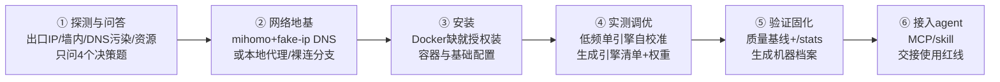

<p align="center">
  
</p>

<h1 align="center">SearXNG Forge</h1>

<p align="center">基于你的现有资源，运行当前网络条件下最高质量的自托管搜索。</p>

<p align="center"><b><a href="README.md">简体中文</a> · <a href="README.en.md">English</a></b></p>

专为 AI 编程助手设计的部署与调优 skill。它在服务器或本地 Docker 环境中，将 [SearXNG](https://github.com/searxng/searxng) 从开箱时的频繁验证码与超时，系统化调优至当前网络条件下的最佳可用状态——涵盖网络基础设施适配、上游引擎动态校准、权重排序，以及接入 AI agent 工具链的完整流程。

## 快速上手（无需终端经验）

若已安装 zcode、Claude Code 等 AI 编程助手，直接将以下提示词发送给助手，由其自主执行：

```text
请帮我部署并调优 SearXNG 自托管搜索引擎。先执行这个安装命令：
curl -fsSL https://raw.githubusercontent.com/Clickist/searxng-forge/main/install.sh | bash
装好后按 searxng-forge 这个 skill 的流程走：先探测环境再问我必要的问题，
系统级操作逐一征求我同意，最后把搜索接入你自己的工具链。
```

熟悉终端操作的用户，也可以手动安装后提示助手“用 searxng-forge 部署调优 SearXNG”：

```bash
curl -fsSL https://raw.githubusercontent.com/Clickist/searxng-forge/main/install.sh | bash
```

## 为什么需要它

自建 SearXNG 的典型痛点在于：容器启动后，DuckDuckGo 频繁弹出验证码、Google 返回空结果、Wikipedia 直接报 403。常规教程多建议“切换备用引擎”，但问题的症结通常不在 SearXNG 的配置文件本身：

- **出口 IP 信誉受限**：机房（IDC）IP 的信誉体系与家庭宽带截然不同，主流搜索引擎默认施加严格风控；
- **DNS 解析受污染**：在特定网络环境下，未经分流与修正的 DNS 查询导致请求根本无法触达正确的源站服务器；
- **客户端指纹触发反爬**：请求特征暴露爬虫属性，导致上游引擎返回“毒化结果”——结构正常，但内容与检索词完全无关。

在底层网络未理顺的前提下，仅调整引擎开关往往收效甚微。**SearXNG Forge 将网络底座建设与服务调优重构为一套强依赖的流水线：**



## 调优实测表现

项目内置 `benchmark.sh` 质量基准脚本，采用 success@5 口径评估 8 组中英文真实查询及权威域名命中情况，为调优前后对比与长期回归提供可量化的指标依据。

实测参考数据（硬件配置：2GB 内存 Armbian 设备；网络环境：境内宿主机配合自建新加坡出口节点）：

| 指标 | 调优前 | 调优后 |
|---|---|---|
| 可用引擎 | 1 个（bing 独苗） | 16+ 个（中英文全梯队） |
| 中文综合查询 | CAPTCHA / 零星结果 | 35 条结果、零失效引擎 |
| success@5 质量基线 | — | **75%**（健康线以上） |
| github / npm / ddg news / google cse | 全部超时 | 全部复活 |

## 为什么它能用三年

自建搜索配置容易失效的根本原因在于：搜索引擎反爬策略与上游接口每月更迭，静态硬编码的规则往往数周内便告失效。本 skill 采用逆向设计思路：

- **沉淀方法，而非固定快照。** skill 记录的引擎经验均标注快照日期，执行时强制进行实机探测；配置模板仅作为初始起点，每台宿主机依据自校准结果生成专属清单。
- **脚本收集客观证据，流程负责决策判定。** 污染特征 IP 与可用引擎列表会变动，但“采集对照样本、依据断言判定”的方法论不会随时间失效。
- **镜像跟进优先于本地配置调整。** SearXNG 官方上游持续跟进反爬对抗（例如 2026 年针对 DuckDuckGo 封锁，官方通过在镜像中内置 curl_cffi 浏览器指纹模拟予以解决）。这一原则已被写入标准操作流程（SOP），避免在旧镜像上进行无意义的调试。

## 诚实的边界

- **出口 IP 信誉属于基础设施限制，而非配置调优所能逆转。** 机房 IP 访问 Google 主引擎基本不可行（SearXNG 上游已默认将其禁用），Bing 的可用性亦不稳定。本 skill 的职责是：将 DuckDuckGo、Brave、Wikipedia、GitHub、arXiv 等机房友好型引擎调优至最佳状态，并清晰标识出当前宿主机环境下客观无法使用的引擎。
- **境内直连且无代理资源的环境**：海外引擎几乎无法正常访问。流程会明确提示当前限制并交由用户决定后续操作，不作不可行的承诺。
- **网络资源前提**：网络出口及带宽需由用户自行提供（包括商业代理订阅、自建代理节点或海外 VPS 宿主机，skill 针对不同形态设有对应的配置分支）。

## FAQ

**Q: 它会对系统产生不可逆的修改吗？**
涉及安装 Docker、配置 mihomo、修改 iptables 等系统级操作时，流程会在执行前明确告知潜在影响并请求明确授权；前期的环境探测均为只读操作，无需系统权限。

**Q: 与直接使用 Google 或 DuckDuckGo 相比有何优势？**
- **隐私保护**：查询请求被随机分散至多个上游引擎，消除单点画像追踪；
- **自主掌控**：拥有独立的配置文件与基线记录，可通过 JSON API 供 AI agent 直接调用；
- **抗单点劣化**：聚合多源检索结果，避免单一商业引擎算法偏差或地区网络劣化带来的服务中断。

**Q: 支持接入哪些 AI Agent？**
兼容以 Agent Skill 形式调用的工具链，以及标准 MCP（Model Context Protocol）生态。SearXNG 本身对外暴露标准免鉴权 JSON API，skill 会在部署完成后为你的常用 Agent 现场生成专用的接入配置与使用说明。

**Q: 如何重新执行质量基线测试？**
运行命令 `bash scripts/benchmark.sh http://127.0.0.1:8080`。建议在网络出口变更、节点切换或 SearXNG 镜像主版本升级后重新执行。

## License

MIT

## 致谢

- [SearXNG](https://github.com/searxng/searxng) 项目与其引擎维护者
- 社区经验参考：SSDNodes [SearXNG Engines to Enable and Disable on a VPS](https://www.ssdnodes.com/learn/searxng-engines-to-enable-and-disable)
